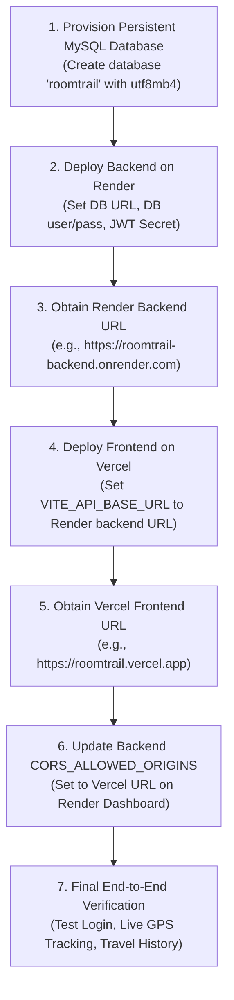

# RoomTrail: Production Deployment Guide (Vercel + Render + MySQL)

This guide documents the complete end-to-end production deployment process for the RoomTrail application:
- **Frontend**: Deployed on [Vercel](https://vercel.com) (React 19 + Vite 8 SPA)
- **Backend**: Deployed on [Render](https://render.com) (Spring Boot 3.3.5, Java 21, Docker Web Service)
- **Database**: Dedicated persistent [MySQL 8.x](https://www.mysql.com) instance (hosted via Aiven, Railway, Clever Cloud, or persistent VPS/Render MySQL)

---

## 1. Project Architecture

```
                                 HTTPS (Port 443)
                         +------------------------------+
                         |        Client Browser        |
                         +--------------+---------------+
                                        |
                 +----------------------+----------------------+
                 |                                             |
                 | Static SPA Assets                           | REST API Calls (/api)
                 v                                             v
  +------------------------------+              +------------------------------+
  |        Vercel (Edge)         |              |       Render (Web Service)   |
  |   React 19 + Vite Frontend   |              |  Spring Boot 3 + Java 21 JRE |
  |   (SPA Rewrite: index.html)  |              |   (Docker Multi-Stage OCI)   |
  +------------------------------+              +--------------+---------------+
                                                               |
                                                               | JDBC SSL (Port 3306)
                                                               v
                                                +------------------------------+
                                                |     Persistent MySQL 8.x     |
                                                |  (Aiven / Railway / Cloud)   |
                                                +------------------------------+
```

---

## 2. Target Project Folder Structure

```text
RoomTrail/
├── frontend/
│   ├── src/                         # React components, pages, hooks, services
│   ├── public/                      # Static assets and favicons
│   ├── .env.example                 # Frontend environment variables template
│   ├── .gitignore                   # Frontend git exclusions (dist, .env, node_modules)
│   ├── vercel.json                  # Vercel SPA routing rewrites & asset caching
│   ├── package.json                 # Frontend dependencies & Vite scripts
│   └── vite.config.js               # Vite build & local dev proxy configuration
│
├── backend/
│   ├── src/                         # Spring Boot controllers, entities, security, services
│   │   └── main/resources/
│   │       ├── application.properties      # Base / Local development configuration
│   │       └── application-prod.properties # Production profile (Environment variables only)
│   ├── pom.xml                      # Maven dependencies (Java 21, Actuator, JJWT, MySQL)
│   ├── Dockerfile                   # Multi-stage production container build (Temurin 21)
│   ├── .dockerignore                # Container build exclusions (target, .git, .env)
│   ├── .gitignore                   # Backend git exclusions (target, .env, logs)
│   └── .env.example                 # Backend environment variables template
│
├── render.yaml                      # Render Blueprint Infrastructure-as-Code specification
├── .gitignore                       # Root git exclusions
└── README-DEPLOYMENT.md             # This comprehensive deployment guide
```

---

## 3. Required Environment Variables

### A. Frontend Environment Variables (Vercel)
Configured in **Vercel Dashboard** &rarr; **Project Settings** &rarr; **Environment Variables**:

| Variable | Description | Example Value |
| :--- | :--- | :--- |
| `VITE_API_BASE_URL` | Full URL to the Spring Boot REST backend `/api` endpoint on Render | `https://roomtrail-backend.onrender.com/api` |

> [!IMPORTANT]
> Vite embeds `VITE_*` variables at **build time**. Whenever you update `VITE_API_BASE_URL` on Vercel, trigger a **Redeploy** so the production bundle rebuilds with the new backend endpoint.

---

### B. Backend Environment Variables (Render)
Configured in **Render Dashboard** &rarr; **Web Service** &rarr; **Environment**:

| Variable | Required? | Description | Example / Recommended Value |
| :--- | :---: | :--- | :--- |
| `SPRING_PROFILES_ACTIVE` | **YES** | Activates production profile with strict security checks | `prod` |
| `PORT` | Auto | Dynamic port injected by Render (defaults to 8080) | `8080` (managed by Render) |
| `SPRING_DATASOURCE_URL` | **YES** | JDBC connection string to your persistent MySQL database | `jdbc:mysql://<DB_HOST>:<DB_PORT>/<DB_NAME>?useSSL=true&serverTimezone=UTC&allowPublicKeyRetrieval=true&characterEncoding=UTF-8` |
| `SPRING_DATASOURCE_USERNAME` | **YES** | MySQL database username | `<YOUR_DB_USER>` |
| `SPRING_DATASOURCE_PASSWORD` | **YES** | MySQL database password | `<YOUR_SECURE_PASSWORD>` |
| `JWT_SECRET` | **YES** | Cryptographic secret for signing JWTs (min 256 bits / 32 chars) | Generated 48-char random base64 string |
| `JWT_EXPIRATION_MS` | Optional | JWT token lifetime in milliseconds | `86400000` (24 hours) |
| `CORS_ALLOWED_ORIGINS` | **YES** | Exact URL(s) of the deployed Vercel frontend | `https://roomtrail.vercel.app` |
| `HIBERNATE_DDL_AUTO` | Optional | Hibernate schema update strategy | `update` |

---

## 4. Frontend Vercel Setup

1. **Sign in to Vercel**: Navigate to [vercel.com](https://vercel.com) and log in.
2. **Add New Project**:
   - Click **Add New...** &rarr; **Project**.
   - Import your Git repository (`RoomTrail`).
3. **Configure Project Settings**:
   - **Framework Preset**: `Vite`
   - **Root Directory**: `frontend` (Click *Edit* and select the `frontend` directory).
   - **Build Command**: `npm run build`
   - **Output Directory**: `dist`
   - **Install Command**: `npm install`
4. **Configure Environment Variables**:
   - Key: `VITE_API_BASE_URL`
   - Value: `https://<YOUR-RENDER-BACKEND-NAME>.onrender.com/api`
   - Target Environments: check *Production*, *Preview*, and *Development*.
5. **Deploy**:
   - Click **Deploy**.
   - Vercel automatically runs `npm install`, executes `npm run build`, and applies `vercel.json` rewrites for client-side routing.

---

## 5. Backend Render Setup

### Method 1: Deploying via Blueprint (`render.yaml`)
1. In the [Render Dashboard](https://dashboard.render.com), click **New** &rarr; **Blueprint**.
2. Connect your Git repository.
3. Render detects `render.yaml` and provisions the `roomtrail-backend` Docker Web Service.
4. Supply the secret values (`SPRING_DATASOURCE_URL`, `SPRING_DATASOURCE_USERNAME`, `SPRING_DATASOURCE_PASSWORD`, `JWT_SECRET`, `CORS_ALLOWED_ORIGINS`) prompted in the dashboard.
5. Click **Apply**.

---

### Method 2: Manual Web Service Setup
1. In the [Render Dashboard](https://dashboard.render.com), click **New** &rarr; **Web Service**.
2. Connect your Git repository.
3. Choose **Docker** as the runtime.
4. Set **Root Directory** to `backend` (or leave empty and set **Docker Context** to `./backend` and **Dockerfile Path** to `./backend/Dockerfile`).
5. Choose **Region** (closest to your database host).
6. Choose the **Free** instance type (or Starter for higher memory).
7. Under **Health Check Path**, enter: `/actuator/health`.
8. Under **Environment Variables**, add:
   ```properties
   SPRING_PROFILES_ACTIVE=prod
   SPRING_DATASOURCE_URL=jdbc:mysql://<HOST>:<PORT>/<DATABASE>?useSSL=true&serverTimezone=UTC&allowPublicKeyRetrieval=true&characterEncoding=UTF-8
   SPRING_DATASOURCE_USERNAME=<DB_USER>
   SPRING_DATASOURCE_PASSWORD=<DB_PASSWORD>
   JWT_SECRET=<STRONG_256_BIT_SECRET>
   CORS_ALLOWED_ORIGINS=https://<YOUR-VERCEL-DOMAIN>.vercel.app
   ```
9. Click **Create Web Service**.

---

## 6. MySQL Hosting Configuration

RoomTrail requires **MySQL 8.x** with the `utf8mb4` character set. Do NOT use PostgreSQL.

### Recommended Managed MySQL Providers

1. **Aiven for MySQL** (Free tier / Managed cloud):
   - Navigate to [aiven.io](https://aiven.io) and create a MySQL service.
   - Enables automated SSL, daily backups, and high availability.
   - Connection URL:
     ```
     jdbc:mysql://<AIVEN_HOST>:<AIVEN_PORT>/roomtrail?useSSL=true&serverTimezone=UTC&characterEncoding=UTF-8
     ```
2. **Railway MySQL**:
   - Navigate to [railway.app](https://railway.app), click *New* &rarr; *Database* &rarr; *MySQL*.
   - Copy the public connection URL from the *Connect* tab.
3. **Clever Cloud MySQL**:
   - Navigate to [clever-cloud.com](https://www.clever-cloud.com) and provision a MySQL add-on.
4. **Self-Hosted MySQL on VPS or Render Persistent Disk**:
   - Run a Dockerized MySQL container with a persistent volume mounted outside the ephemeral container filesystem.

---

## 7. CORS Configuration

Spring Security enforces explicit origin validation when `SPRING_PROFILES_ACTIVE=prod`.

- Set `CORS_ALLOWED_ORIGINS` to the exact protocol and domain of your Vercel deployment:
  ```properties
  CORS_ALLOWED_ORIGINS=https://roomtrail.vercel.app
  ```
- If you have multiple domains (e.g. custom domain + Vercel subdomain), separate them with commas:
  ```properties
  CORS_ALLOWED_ORIGINS=https://roomtrail.vercel.app,https://www.roomtrail.com
  ```
- **Security Rules**:
  - Do NOT include trailing slashes (e.g. use `https://app.vercel.app`, not `https://app.vercel.app/`).
  - Do NOT use wildcard `*` (Spring Security disables wildcards when cookies/credentials are supported).
  - Preflight `OPTIONS` requests are automatically permitted anonymously.

---

## 8. Production Profile Activation & Security Validator

When `SPRING_PROFILES_ACTIVE=prod` is set:
1. Spring Boot loads `application-prod.properties`.
2. `ProductionSecurityValidator.java` runs on startup and aborts if:
   - `SPRING_DATASOURCE_URL` is missing or points to `localhost` / `127.0.0.1`.
   - `SPRING_DATASOURCE_PASSWORD` is empty or uses insecure defaults (`root`, `password`).
   - `JWT_SECRET` is less than 32 characters or uses known template values.
   - `CORS_ALLOWED_ORIGINS` is missing, contains wildcards, or points to localhost.
3. `DataInitializer.java` detects the `prod` profile and **skips demo data seeding and password resets**, protecting existing production records.

---

## 9. Recommended Deployment Order

Follow this sequence to ensure zero downtime and prevent CORS errors:



---

## 10. Database Backup and Migration Safety

Before pointing a production instance at an existing database, always create a full backup.

### Creating a MySQL Backup
```bash
# Dump complete database with routines, triggers, and utf8mb4 characters
mysqldump -u <DB_USER> -p -h <DB_HOST> -P <DB_PORT> \
  --single-transaction \
  --quick \
  --default-character-set=utf8mb4 \
  --routines --triggers \
  roomtrail > roomtrail_backup_$(date +%Y%m%d_%H%M%S).sql
```

### Restoring a Backup to Cloud MySQL
```bash
mysql -u <DB_USER> -p -h <DB_HOST> -P <DB_PORT> \
  --default-character-set=utf8mb4 \
  roomtrail < roomtrail_backup.sql
```

---

## 11. Health-Check Verification

The Spring Boot backend exposes a production-safe health endpoint:
```http
GET /actuator/health
```

### Expected Response (HTTP 200 OK):
```json
{
  "status": "UP"
}
```

- Permitted anonymously by Spring Security.
- Internal component details and credentials are hidden (`management.endpoint.health.show-details=never`).
- Render uses this path to determine when a container is healthy before routing live traffic.

---

## 12. Troubleshooting Common Deployment Errors

| Symptom | Cause | Solution |
| :--- | :--- | :--- |
| **Render: CRITICAL PRODUCTION SECURITY FAILURE** | Missing or weak environment variable in production | Check Render logs. Ensure `SPRING_DATASOURCE_URL`, `SPRING_DATASOURCE_PASSWORD`, `JWT_SECRET` ($\ge 32$ chars), and `CORS_ALLOWED_ORIGINS` are set without localhost. |
| **Vercel: Direct refresh on `/tracking` returns 404** | Missing SPA rewrite rule | Ensure `frontend/vercel.json` contains `rewrites: [{"source": "/(.*)", "destination": "/index.html"}]`. |
| **Browser: CORS error / Preflight blocked** | Frontend origin not in `CORS_ALLOWED_ORIGINS` | Verify `CORS_ALLOWED_ORIGINS` on Render matches your exact Vercel URL without trailing slash. |
| **Render: Container failed to bind to port** | Hardcoded port 8080 in runtime | Ensure `Dockerfile` runs with `-Dserver.port=${PORT:-8080}` so it dynamically binds to Render's allocated `$PORT`. |
| **GPS: Location permission denied or unavailable** | Insecure HTTP origin | Geolocation API requires HTTPS. Vercel automatically provisions SSL (`https://`). |
| **Database connection timeout during active trips** | Connection pool exhaustion | `application-prod.properties` configures HikariCP with `maximum-pool-size=10` and `idle-timeout=30000`. |

---

## 13. Updating and Redeploying Frontend & Backend Separately

### Redeploying Frontend (Vercel)
- Any push to the production branch automatically triggers a Vercel build.
- To redeploy manually from the Vercel Dashboard: **Deployments** &rarr; Select latest &rarr; Click **Redeploy**.

### Redeploying Backend (Render)
- Any push to the production branch triggers a Docker rebuild on Render.
- To redeploy manually from the Render Dashboard: Click **Manual Deploy** &rarr; **Deploy latest commit** (or **Clear build cache & deploy**).
